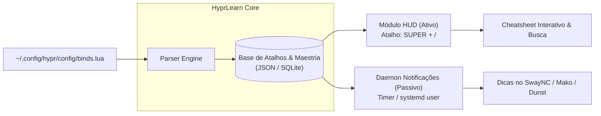

# Especificação de Requisitos: HyprLearn (HUD + Micro-Learning)

**Nome do Projeto (Sugestão):** `HyprLearn` (ou `HyprHUD-Learner`)  
**Contexto:** Hyprland sob Wayland, consumindo configurações de atalhos estruturadas em Lua (`~/.config/hypr/config/binds.lua`).

---

## 1. Visão Geral e Proposta de Valor

O objetivo deste projeto é combinar **consulta ativa sob demanda** (HUD) com **aprendizado passivo contextual** (Micro-Learning via notificações periódicas), reduzindo a curva de memorização de atalhos do Hyprland sem atrapalhar a produtividade.



---

## 2. Componentes da Solução

1. **Parser Engine:** Módulo responsável por ler e interpretar o arquivo [`binds.lua`](file:///home/luiz/.config/hypr/config/binds.lua), extraindo combinador de teclas, ação/comando e categorias dos comentários (`-- WINDOW MANAGEMENT`, etc.).
2. **HyprHUD (Módulo Ativo):** Interface rápida acionada via tecla de atalho (`SUPER + /`), com busca difusa (*fuzzy search*), visualização agrupada e visual moderno.
3. **Micro-Learning Daemon (Módulo Passivo):** Serviço leve em background que envia notificações periódicas com dicas de atalhos, com priorização inteligente (foco nos atalhos menos fixados na memória).
4. **Learning State Tracker:** Armazena o nível de maestria de cada atalho, histórico de visualizações e preferências do usuário.

---

## 3. Requisitos Funcionais (RF)

### 3.1. Parser & Sincronização Dinâmica
* **RF01.1 - Parsing do Lua:** O sistema deve analisar [`binds.lua`](file:///home/luiz/.config/hypr/config/binds.lua) identificando:
  - Modificadores (`SUPER`, `SHIFT`, `ALT`, `CTRL`);
  - Tecla de acionamento (inclusive tratando atalhos com keycode/AZERTY e aliases);
  - Ação disparada (`window.close`, `window.move`, `exec_cmd`, etc.);
  - Categoria extraída dos blocos de cabeçalho e comentários imediatamente adjacentes.
* **RF01.2 - Sincronização Automática:** Atualizar a base de dados em memória ou cache sempre que o arquivo [`binds.lua`](file:///home/luiz/.config/hypr/config/binds.lua) sofrer alterações (monitoramento com `inotify`).
* **RF01.3 - Suporte a Fallback:** Capacidade complementar de consultar `hyprctl binds -j` para mapear binds que venham de módulos externos.

### 3.2. HyprHUD (Consulta Sob Demanda)
* **RF02.1 - Invocação Rápida:** Abrir instantaneamente via atalho global (ex: `SUPER + /` ou `SUPER + F1`) em menos de 100ms.
* **RF02.2 - Visualização por Categorias:** Apresentar atalhos agrupados em cards/colunas:
  - *Gerenciamento de Janelas* (fechar, flutuar, fullscreen, split);
  - *Navegação & Foco* (setas, monitores, workspaces);
  - *Lançadores & Apps* (terminal, navegador, window switcher);
  - *Mídia & Sistema*.
* **RF02.3 - Busca Difusa (Fuzzy Search):** Permitir buscar tanto pela descrição ("mover janela") quanto pelas teclas ("SUPER SHIFT").
* **RF02.4 - Ações Rápidas:**
  - `Enter`: Executa a ação do atalho diretamente (ou fecha o HUD);
  - `Alt+Enter` / `Ctrl+C`: Copia o atalho ou comando para a área de transferência (`wl-copy`);
  - `Tab`: Alterna entre categorias.
* **RF02.5 - Marcação de Favoritos / "Aprendendo":** Permitir marcar atalhos que você quer focar no micro-learning.

### 3.3. Micro-Learning & Notificações Passivas
* **RF03.1 - Notificações Agendadas:** Emitir uma notificação em intervalos configuráveis (padrão: a cada 45 minutos) com um atalho do sistema.
* **RF03.2 - Formato da Notificação:**
  - Título: Categoria + "Dica do Hyprland" (ex: `💡 Hyprland: Navegação de Foco`);
  - Corpo: Visual estilizado com as teclas em destaque e descrição legível (ex: `SUPER + Left` ➔ `Focar janela à esquerda`);
  - Ações interativas (se suportado pelo daemon de notificações via `notify-send -A` / SwayNC):
    - *Botão 1:* "Já decorei" (aumenta o nível de maestria);
    - *Botão 2:* "Lembrar mais tarde" (reagenda para breve);
    - *Botão 3:* "Testar agora" (executa o comando).
* **RF03.3 - Modo Não-Perturbe Inteligente:**
  - Pausar notificações se o usuário estiver jogando ou em modo fullscreen (verificado via `hyprctl activewindow -j`).
  - Respeitar horários de pausa configurados.
* **RF03.4 - Algoritmo de Seleção Ponderada:** Não exibir atalhos de forma 100% aleatória:
  - Atalhos marcados como "novos" ou "difíceis" aparecem com frequência maior.
  - Atalhos já memorizados aparecem em intervalos espaçados (Spaced Repetition simplificado).

### 3.4. Dica no Terminal (Opcional Integrado)
* **RF04.1 - Hook para Shell (Bash/Zsh):** Utilitário CLI rápido (`hyprlearn tip`) para exibir uma dica de uma linha ao abrir um novo terminal.

---

## 4. Requisitos Não Funcionais (RNF)

* **RNF01 - Compatibilidade Wayland Nativa:** Toda interface gráfica deve ser compatível com Wayland (usando camada Wayland do GTK4/Adwaita, Rofi-Wayland ou TUI em terminal flutuante `alacritty`/`kitty`).
* **RNF02 - Baixo Consumo de Recursos:** O daemon de background não deve consumir mais de 15-20 MB de RAM e deve ficar inativo na maior parte do tempo.
* **RNF03 - Armazenamento Local e Transparente:** Dados de configuração e progresso devem ficar no padrão XDG:
  - Configurações: `~/.config/hyprlearn/config.toml` ou `.json`;
  - Estado/Progresso: `~/.local/share/hyprlearn/learning_stats.json`.
* **RNF04 - Latência do HUD:** Tempo de abertura do HUD inferior a 150ms.

---

## 5. Estrutura de Dados e Armazenamento

### Exemplo de Registro de Atalho (`binds_cache.json`)
```json
{
  "id": "win_close",
  "category": "WINDOW MANAGEMENT",
  "sub_category": "Window manipulation",
  "combo": ["SUPER", "Q"],
  "display_combo": "SUPER + Q",
  "action": "hl.dsp.window.close()",
  "description": "Fechar janela ativa",
  "mastery_level": 3,
  "times_shown": 12,
  "last_seen_timestamp": 1729098400,
  "is_favorite": true
}
```

---

## 6. Opções de Arquitetura & Stack Tecnológica

| Abordagem | Interface HUD | Daemon de Notificação | Vantagens | Complexidade |
| :--- | :--- | :--- | :--- | :--- |
| **Opção A: Python + Rofi/FZF + Notify-Send** | `rofi-wayland` estilizado ou script TUI com `fzf` | Daemon Python leve + `notify-send` | Extremamente leve, integração nativa com o ecossistema Hyprland existente, fácil manutenção | Baixa / Média |
| **Opção B: Python + Textual (TUI Flutuante)** | Janela flutuante minimalista com `textual` | Thread em background ou timer systemd | Interface muito bonita, suporte a atalhos de teclado nativos, fácil de customizar temas | Média |
| **Opção C: Rust / Go + GTK4 / Layer Shell** | Overlay gráfico nativo com Wayland layer-shell | Daemon compilado em binário único | Performance extrema, inicialização instantânea, visual estilo macOS/Spotlight | Alta |
